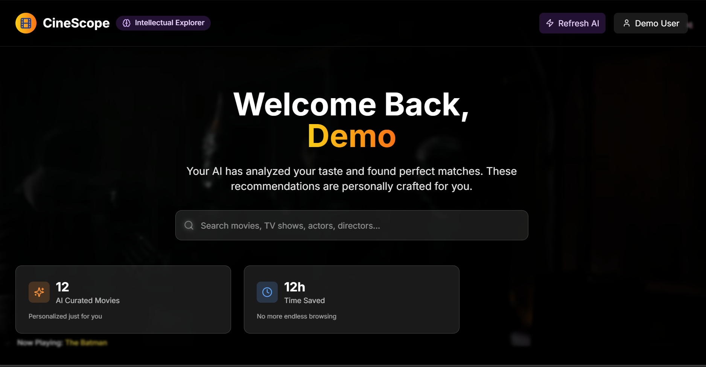
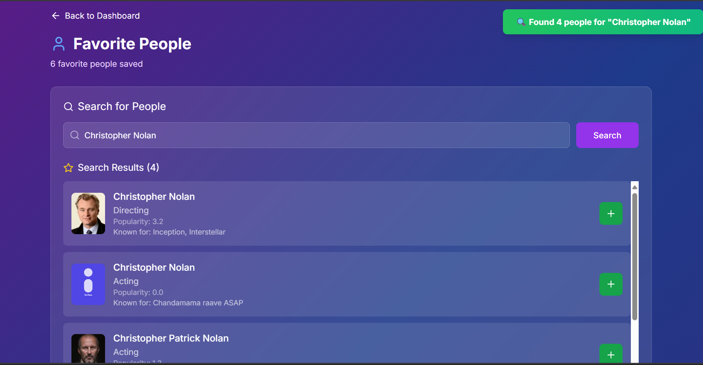
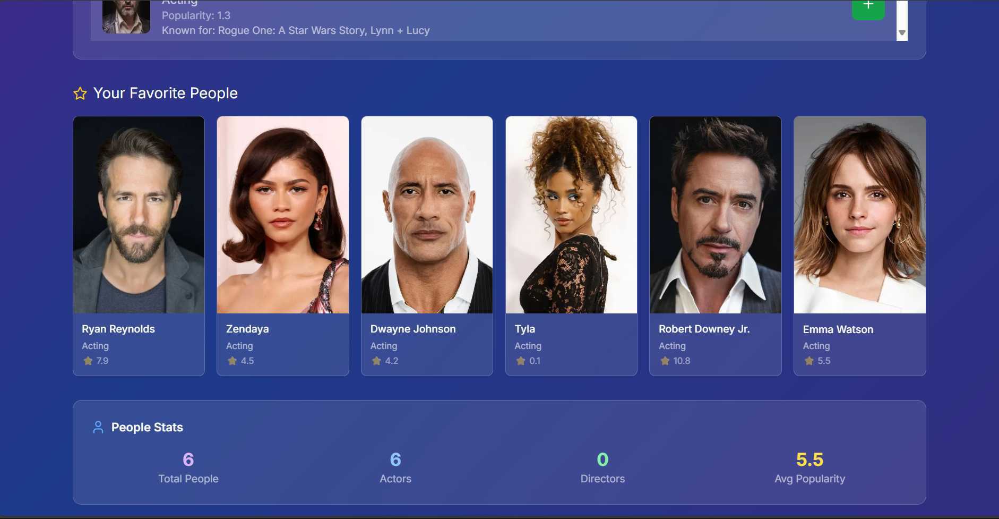
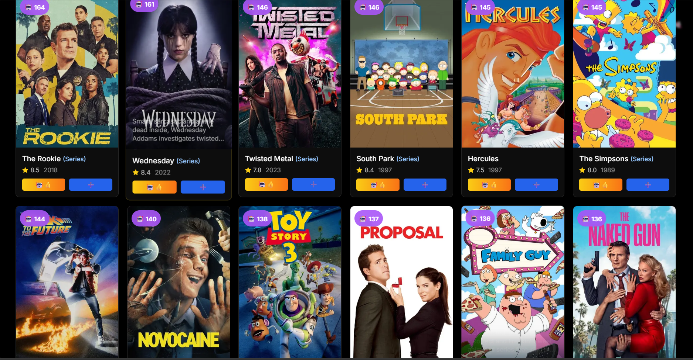

# 🎬 CineScope

**Your AI-Powered Movie Companion**

Never wonder what to watch again. CineScope uses advanced AI to understand your unique taste and delivers movie recommendations so perfect, you'll feel like we're reading your mind.


## Screenshots

### Home Page



### Search Page



### Movie Page



### Profile Page



## ✨ Features

### 🧠 AI Personality Analysis
- Deep psychological profiling from your movie preferences
- Understands what you really love, not just what you rate highly
- Adapts to your mood and viewing context

### 🎯 Context-Aware Recommendations
- Different suggestions for date night vs solo viewing
- Time-based recommendations (morning energy vs late-night atmosphere)
- Mood-sensitive picks based on your current state

### ⏰ Smart Timing Notifications
- Learns your optimal viewing times
- Sends personalized recommendations at perfect moments
- Respects your schedule and preferences

### 👥 Social Discovery
- Import your IMDB watchlist seamlessly
- Find users with similar taste
- Safe, moderated community reviews
- Friend recommendations based on compatibility scores

### 🛡️ Safety & Privacy First
- Content moderation and spoiler protection
- Rate limiting and spam prevention
- Privacy-focused design with optional social features

## 🚀 Tech Stack

**Frontend**
- Next.js 14 - React framework with App Router
- TypeScript - Type safety and better developer experience
- Tailwind CSS - Utility-first styling
- Framer Motion - Smooth animations and interactions

**Backend**
- Next.js API Routes - Serverless functions
- Cloud Firestore - Saved profiles, onboarding, watchlists, ratings, and friends
- Firebase Authentication - Email/password credentials
- NextAuth.js - Application sessions
- Prisma - Model types and optional legacy PostgreSQL backend

### Migrating from Supabase

The Firebase destination is **`cinescope-27dd6`**, with a Standard Firestore database named `(default)` in **`us-east4`**. Firebase owns password credentials; Firestore profiles retain the original user IDs and exclude password hashes. The Next.js API uses a server service account with `roles/datastore.user`; `firestore.rules` denies all direct client access.

1. Freeze source writes and retain the private backup. For a plain Supabase dump or gzip download, run `node scripts/stage-supabase-backup.cjs <backup> <existing-private-directory>`, then `node scripts/stage-firestore-import.cjs <backup> <private-path>.cinescope-firestore.json`. Keep all account exports, service account keys, and staging files outside source control.
2. Deploy the checked-in configuration with `firebase deploy --only auth,firestore --project cinescope-27dd6`. Before importing Auth, export the destination with `firebase auth:export <private-destination>.cinescope-auth.json --format=json --project cinescope-27dd6` and confirm it is empty. A bulk Auth import can overwrite matching UIDs.
3. Import the staged accounts using `firebase auth:import <private-path>.cinescope-auth.json --hash-algo=BCRYPT --project cinescope-27dd6`. Export again and compare all UIDs, normalized emails, and status flags. The recovery snapshot contains **17 accounts**.
4. Set `FIREBASE_PROJECT_ID=cinescope-27dd6` and `GOOGLE_APPLICATION_CREDENTIALS` to the private server key path for standalone import scripts. Run `node scripts/import-firestore.cjs <private-path>.cinescope-firestore.json` for a preflight, then repeat with `--apply`. Existing identical documents are skipped; changed destination records stop the import. Run `node scripts/verify-firestore.cjs <private-path>.cinescope-firestore.json` before application writes begin to compare every field, collection count, and linked record.
5. Configure the next production build with `FIREBASE_PROJECT_ID`, `FIREBASE_AUTH_API_KEY`, `FIREBASE_SERVICE_ACCOUNT_JSON`, a new `NEXTAUTH_SECRET`, and the public `NEXTAUTH_URL`. These values are server-only. Run `npm run build`, then `vercel deploy --prod --skip-domain --yes` to stage the build while keeping public domains on the existing deployment.
6. On the staged deployment, verify an imported account with its original password, session identity, saved onboarding, all watchlist statuses, ratings, and friends. Test new-account sign-in and save/reload operations with a temporary account, then remove that account and its records. Promote the same tested build using `vercel promote <staged-deployment-url>` only after verification succeeds.

The snapshot contains **524 documents**: 17 users, 247 movies, 3 onboarding records, 3 watchlists, 245 watchlist items, 8 ratings, and 1 follow. New saves can legitimately increase these counts after cutover. Do not rerun strict snapshot comparison after users start writing.

Set both Firebase variables to select the migrated backend. Leaving both unset selects legacy sign-in and PostgreSQL. Keep the private source snapshot for recovery. After users begin writing to Firebase, reconcile new accounts and activity before rolling back; assigning the old deployment alone does not reconcile data.

**AI & Data**
- TMDB API - Movie data and posters
- OpenAI API - Personality analysis and recommendations
- Custom ML Models - Collaborative filtering and taste matching

## 🛠️ Getting Started

### Prerequisites
- Node.js 18+
- PostgreSQL database
- TMDB API key

### Installation

**Clone the repository**
```bash
git clone https://github.com/teddexter0/cineScope.git
cd cinescope
```

**Install dependencies**
```bash
npm install
```

**Set up environment variables**
```bash
cp .env.example .env.local
```

Fill in your `.env.local`:
```env
FIREBASE_PROJECT_ID="cinescope-27dd6"
FIREBASE_AUTH_API_KEY="your-firebase-web-api-key"
FIREBASE_SERVICE_ACCOUNT_JSON='your-private-service-account-json'
NEXTAUTH_SECRET="your-secret-key"
NEXTAUTH_URL="http://localhost:3000"
TMDB_API_KEY="your-tmdb-api-key"
```

**Optional legacy PostgreSQL setup**
```bash
npx prisma db push
npx prisma generate
```

**Run the development server**
```bash
npm run dev
```

**Open http://localhost:3000**

## 📝 Environment Variables

| Variable | Description | Required |
|----------|-------------|----------|
| FIREBASE_PROJECT_ID | Firestore project (`cinescope-27dd6`) | Firebase backend |
| FIREBASE_AUTH_API_KEY | Firebase web API key for email/password Auth | Firebase backend |
| FIREBASE_SERVICE_ACCOUNT_JSON | Private server service account JSON | Firebase backend |
| GOOGLE_APPLICATION_CREDENTIALS | Private key file path, alternative to inline JSON | Import scripts / local server |
| DATABASE_URL | PostgreSQL connection string | Legacy backend only |
| NEXTAUTH_SECRET | Secret for JWT signing | ✅ |
| NEXTAUTH_URL | Your app's URL | ✅ |
| TMDB_API_KEY | The Movie Database API key | ✅ |

Get API Keys:
- **TMDB API**: https://www.themoviedb.org/settings/api
- **OpenAI API**: https://platform.openai.com/api-keys

## 🏗️ Project Structure

```
cinescope/
├── app/                    # Next.js App Router
│   ├── (auth)/            # Authentication pages
│   ├── api/               # API routes
│   ├── dashboard/         # Main app pages
│   └── onboarding/        # User onboarding flow
├── lib/                   # Utility functions
├── prisma/                # Database schema
└── public/                # Static assets
```

## 🎯 Roadmap

### Phase 1: Core Features ✅
- [x] User authentication
- [x] Movie search and display
- [x] Basic recommendations
- [x] Personality analysis onboarding

### Phase 2: Smart Features 🚧
- [x] AI-powered recommendations
- [x] Smart timing notifications
- [ ] IMDB watchlist import
- [ ] Social features

### Phase 3: Advanced Features 📋
- [ ] Mobile push notifications
- [ ] Real-time watch parties
- [ ] Advanced analytics dashboard
- [ ] API for third-party integrations

## 🤝 Contributing

We love contributions! Please see our Contributing Guide for details.

1. Fork the repository
2. Create a feature branch: `git checkout -b feature/amazing-feature`
3. Commit changes: `git commit -m 'Add amazing feature'`
4. Push to branch: `git push origin feature/amazing-feature`
5. Open a Pull Request

## 📄 License

This project is licensed under the MIT License - see the LICENSE file for details.

## 📬 Contact

**Ted Dexter Sande** - [@teddexter0](https://github.com/teddexter0) - teddexter0@gmail.com

Project Link: https://github.com/teddexter0/cineScope

---

**Built with ⚡ and lots of ☕**

*CineScope - Because life's too short for bad movies*# Updated Mon, Aug 18, 2025 12:37:35 AM
